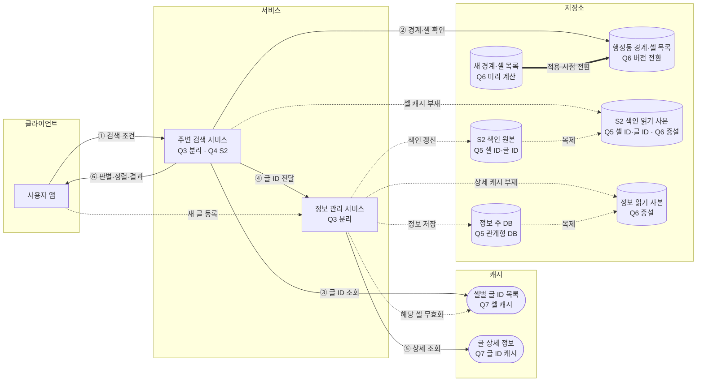

# 1장 근접성 서비스 — 이태환 · S4 우리동네

> **한 줄 요약**: S2와 새 경계 폴리곤으로 동네를 검색하고, 관계형 DB의 읽기 사본과 캐시를 사용하며 새 글을 1분 이내에 반영한다.

## 1. 전제

| 핵심 숫자 | 값 | 계산식 |
|---|---|---|
| 평균 / 피크 검색 QPS | 960 / 9,600 | 800만 × 12 / 10만 초, 피크 10배 가정 |
| 사업장·판매글 위치 | 1,500만 개 | 시나리오 기준 |

- **교재와 다른 제약**: 행정동·인접 동 검색과 동네 이탈 감지, 새 판매글 5분 이내 반영, 상시 위치 추적 금지.

## 2. 결정 7개

| # | 결정 | 내 선택 | 근거 (한 줄) | 감수한 것 |
|---|---|---|---|---|
| Q1 | 규모 | 평균 960 QPS, 피크 9,600 QPS 가정; DB 병목 예상 | 위치에 맞는 동네 데이터는 계속 읽지만 작성은 때때로 발생; DB에 여러 사용자의 데이터 전송이 집중 | 피크 10배는 가정 |
| Q2 | 반영 시점·반경 | 새 글 1분 이내 반영; 결과가 적으면 10km 또는 15km까지 확장 가능 | 초 단위 복제는 비용이 커질 수 있고 키워드에 따라 검색 결과의 밀도도 다름 | 범위를 너무 넓히면 우리 동네라는 의미가 약해짐 |
| Q3 | API·서비스 | 커서 기반 목록과 거리·조회수·평점 정렬; 주변 검색·정보 관리 분리, ID로 상세 정보 조회 | 정보 관리는 DB를 사용하고 주변 검색은 지역 색인을 활용 | 서비스 간 호출과 부하 확인 필요 |
| Q4 ★ | 공간 색인 | S2; 작은 동과 넓은 동을 고려해 셀 크기·개수를 정하고 검색 시간으로 조정; 경계 후보는 폴리곤으로 확인 | 불규칙한 행정동 경계를 셀로 표현하고 새 글을 셀에 추가 가능 | 셀 개수에 따른 검색 비용 측정 필요 |
| Q5 | 저장소 | 관계형 DB와 읽기 사본; S2 셀 ID·글 ID를 한 쌍씩 저장 | 동시 등록 시 충돌을 줄이고 복제 지연을 확인해 1분 이내 반영 | 복제 및 색인 반영 지연 확인 필요 |
| Q6 | DB 확장·경계 변경 | 상세 정보와 S2 색인의 읽기 사본 증설; 새 경계·셀 목록을 미리 계산해 적용 시점에 전환 | 복제 지연 확인; 새 폴리곤으로 경계 후보 확인 | 복제 지연 확인 필요 |
| Q7 | 캐시 | S2 셀 ID→글 ID 목록과 글 ID→상세 정보; 새 글 등록 시 해당 셀 무효화, 경계 변경 시 새 버전 사용 | 전체 반영 시간 1분 이내 확인 | 색인·복제·캐시 갱신 순서 확인 필요 |

## 3. 시스템 전체 설계도

실선 = 주변 검색 · 점선 = 쓰기·비동기 · 굵은 선 = 돌발 대응

![[근접성설계_이태환_2026-10-28.excalidraw]]

**주변 검색**: ① 검색 조건 전달 → ② 경계와 S2 셀 확인 → ③ 글 ID 조회 → ④ 정보 관리 서비스에 ID 전달 → ⑤ 상세 정보 조회 → ⑥ 행정동 검색은 폴리곤 판별 후 정렬·결과 반환.

## 4. 교재와 다르게 간 곳

| 결정 | 교재 | 나 | 이 시나리오에서 왜 |
|---|---|---|---|
| 공간 색인 | 지오해시 | S2와 폴리곤 판별 | 불규칙한 행정동 경계를 셀로 표현 |
| 새 글 반영 | 다음날 반영 허용 | 1분 이내 | 시나리오의 5분 이내 요구를 만족 |

## 5. 미팅 안건

- **가장 자신 없는 결정**: Q4의 S2 셀 크기와 최대 개수.
- **같이 이야기할 질문**: 면적과 밀도가 다른 행정동에서 셀 크기와 최대 개수를 어떤 지표로 정하고 검증할까?
