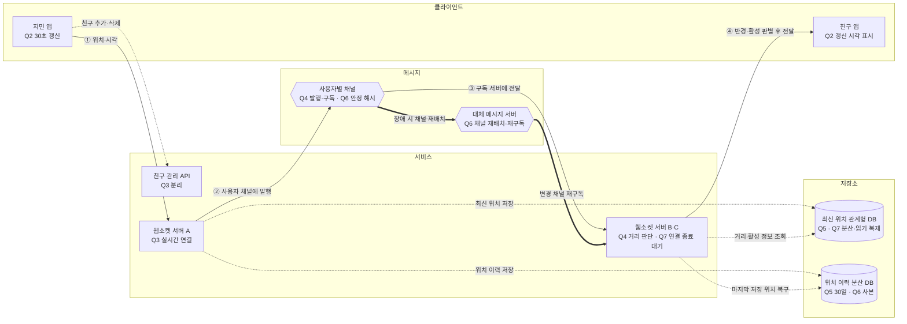

# 2장 주변 친구 — 이태환 · S1 동네친구

> **한 줄 요약**: 웹소켓과 사용자별 발행·구독으로 위치를 전달하고, 최신 위치는 관계형 DB에, 30일 이력은 분산 DB에 보관한다.

## 1. 전제

| 핵심 숫자 | 값 | 계산식 |
|---|---|---|
| 위치 갱신 QPS | 약 66,667 | 동시 접속 2,000만 × 10% ÷ 30초 |
| 반경 안 활성 친구에게 보내는 메시지 | 약 100만 건/초 | 위치 갱신 QPS × 평균 친구 150명 × 10% |

- **교재와 다른 제약**: 국내 서비스, 동시 접속 200만 명, 반경 5km, 선택적 위치 공유 및 위치 이력 30일 보관.

## 2. 결정 7개

| # | 결정 | 내 선택 | 근거 (한 줄) | 감수한 것 |
|---|---|---|---|---|
| Q1 | 규모 | 동시 접속 200만 명; 갱신 약 6만 6,667건/초; 반경 안 활성 친구에게 전송 약 100만 건/초 | 평균 친구 150명의 10%인 15명에게 전달 | 실제 내부 전파량은 거리 필터 위치에 따라 다를 수 있음 |
| Q2 | 갱신·활성 | 30초 고정 갱신; 마지막 위치 갱신 5분 이내면 활성; 마지막 갱신 시각 표시 | 위치 갱신에 따른 통신·쓰기 부하를 고려하고 속도·배터리별 조절은 초기에 오버스펙으로 판단 | 최근 갱신 기준의 활성 상태와 현재 연결 상태는 다를 수 있음 |
| Q3 | 통신·서버 | 웹소켓; 친구 관리 API 서버와 실시간 연결 서버 분리 | 위치 갱신이 급증하면 실시간 연결 서버를 별도로 늘릴 수 있음 | 서버군을 각각 배포·관리해야 하므로 운영 복잡도 증가 |
| Q4 ★ | 위치 변경 전파 | 친구 전체의 사용자별 채널을 구독; 위치를 발행하고 구독 측 서버에서 5km 반경 판단 | 전송마다 친구가 연결된 서버를 찾는 번거로움이 줄고, 반경 밖 친구도 다시 가까워졌는지 파악 가능 | 구독 관리와 장애 후 재구독 필요 |
| Q5 | 위치 저장 | 최신 위치는 관계형 DB; 위치 이력은 분산 DB에 30일 보관 | 메모리 백업 이후의 갱신 손실을 우려해 최신 위치를 안정적으로 보관하고, 이력 쓰기 부하를 나눔 | 관계형 DB의 갱신 처리량과 복구 수준을 확인해야 함 |
| Q6 | 메시지 서버 확장 | 안정 해시로 장애 서버의 채널 재배치 및 구독 재시도; 이력 DB에서 마지막 위치 복구 | 정상 채널은 유지하고 장애 채널만 다시 구독; 위치 이력은 사본으로 보관 | 15명 수신 가정의 최소 30대는 여유가 없고 내부 전달량의 실제 측정이 필요 |
| Q7 | 웹소켓·DB 확장 | 신규 연결 분산, 기존 연결 종료 대기 후 기한이 지나면 재연결 안내; 최신 위치 DB를 나누고 조회 부하에 따라 복제 | 기존 연결의 일괄 중단을 줄이고 쓰기·읽기 부하에 대응 | DB 분할 기준과 연결 대기 기한 미정; 이력 저장 경로의 유실 대응 확인 필요 |

> 바뀐 결정: Q4 발행 측 거리 판별 → 구독 측 판별; Q5 최신 위치 메모리 기반 저장소 → 관계형 DB.

## 3. 시스템 전체 설계도

실선 = 위치 갱신 전파 · 점선 = 저장·조회·부가 흐름 · 굵은 선 = 장애 대응

![[주변친구설계_이태환_2026-10-30.excalidraw]]

**위치 갱신 → 친구 화면 반영**: ① 지민 앱이 위치·시각을 전송 → ② 서버 A가 사용자 채널에 발행 → ③ 구독 서버에 전달 → ④ 구독 서버가 거리와 활성을 판별하고 친구 앱에 전달. 최신 위치와 30일 이력은 별도 저장.

## 4. 교재와 다르게 간 곳

| 결정 | 교재 | 나 | 이 시나리오에서 왜 |
|---|---|---|---|
| 최신 위치 저장 | 메모리 기반 위치 정보 캐시 | 관계형 DB | 메모리 백업 이후의 갱신이 장애 시 사라질 수 있어 안정적으로 보관하고 싶음 |

## 5. 미팅 안건

- **가장 자신 없는 결정**: 웹소켓 서버와 DB.
- **같이 이야기할 질문**: 피크 갱신을 처리하면서 웹소켓 연결을 안정적으로 배포·복구하고 최신 위치 DB를 어떻게 나누고 복제할까?
