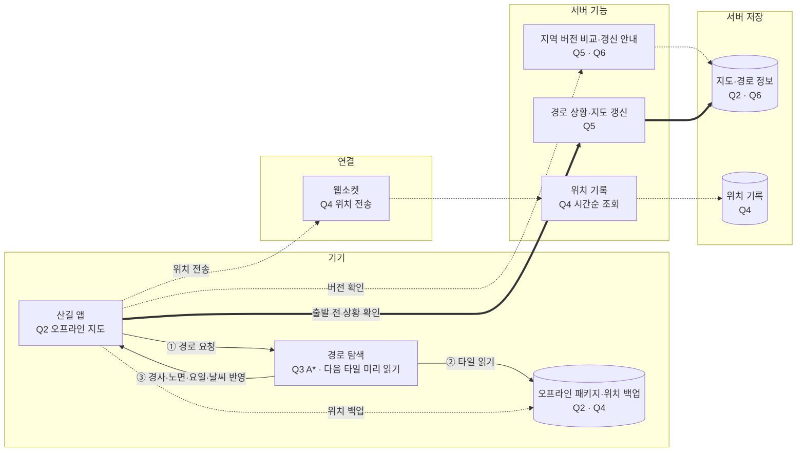

# 3장 구글 맵 — 태환 · S4 산길

> **한 줄 요약**: 지역별 오프라인 지도와 경로 안내 타일을 기기에 저장하고 A*로 탐색하며, 연결 시 위치 기록과 지도 버전을 갱신한다.

## 1. 전제

| 핵심 숫자 | 값 | 계산식 |
|---|---|---|
| 위치 갱신 평균 / 피크 QPS | 7,200 / 28,800 | 100만 × 180 × 60 / 10⁵ / 15, 피크 × 4 (15초 묶음 가정) |
| 공원 지도 다운로드 | 약 1.67GB/인, 1만 명 약 16.7TB | 500 / 0.04 × 100KB × 4/3 |

- **교재와 다른 제약**: 산간 구간 30% 이상 통신 불가, 경사·노면을 고려하며 GPS 기록을 영구 보관한다.

## 2. 결정 6개

| # | 결정 | 내 선택 | 근거 (한 줄) | 감수한 것 |
|---|---|---|---|---|
| Q1 | 규모 | 위치 평균 7,200·피크 28,800 QPS; 지도 약 1.67GB/인 | 연결 복구 시 업로드와 동시 지도 다운로드가 몰림 | 위치 QPS는 15초 묶음 가정 |
| Q2 | 지도 표시 | 지역 단위 오프라인 패키지, 기기에서 타일 조회 | 통신이 끊겨도 지도를 볼 수 있음 | 패키지와 타일 정보 보관 부담 |
| Q3 | 경로 탐색 ★ | 기기에서 경로 안내 타일로 A* 탐색, 다음 타일 미리 읽기 | 통신 없이 경사·노면을 고려한 경로 탐색 | 사용하지 않는 타일을 읽을 수 있음 |
| Q4 | 위치 기록 | 웹소켓 전송, 미전송 기록 기기 백업, 서버에서 시간순 조회 | 연결이 복구되면 기록 전송 | 전송 주기와 사용자·활동 구분 기준 미정 |
| Q5 | 돌발 대응 | 출발 전 경로 상황 안내와 지도 갱신; 통제 정보 변경분 우선 동기화 제안 | 통신 전 알려진 상황 전달, 연결 시 새 통제 반영 | 완전히 오프라인인 기기에는 새 통제를 즉시 전달할 수 없음 |
| Q6 | 비용·갱신 | 거리·경사·노면별 평균 속도에 요일·날씨 가중치; 앱 실행 시 버전 비교와 갱신 안내 | 좀 더 정확한 소요 시간, 최신 버전 안내 | 오프라인 날씨 신선도·갱신 범위 미정 |

## 3. 시스템 전체 설계도

실선 = 경로 안내 · 점선 = 쓰기·비동기 · 굵은 선 = 돌발 대응

![[구글맵설계_태환_2026-11-01.excalidraw]]

**경로 안내 요청 → 경로·ETA 응답**: ① 기기에서 경로 요청 → ② 저장된 경로 안내 타일을 읽으며 A* 탐색 → ③ 거리·경사·노면과 요일·날씨를 고려해 소요 시간과 경로 표시 (지오코딩·순위 결정 방식 미정)

통제 정보는 지도와 별도로 버전·구간·상태·발생 시각을 관리한다. 출발 전과 연결 복구 시 변경분을 먼저 받고 현재 경로를 검사해, 폐쇄 구간이 있으면 기기에서 우회 경로를 계산한다. 오프라인에서는 마지막 확인 시각과 새 통제 여부를 알 수 없다는 점을 표시한다. 안전한 대안 경로를 찾지 못하면 이를 알린다. 현장 Wi-Fi나 기기 간 중계는 추가 전달 수단으로 검토하되 수신을 보장하지 않는다.

## 4. 교재와 다르게 간 곳

| 결정 | 교재 | 나 | 이 시나리오에서 왜 |
|---|---|---|---|
| 지도·경로 탐색 | 연결된 서버와 CDN 중심 | 지역 패키지와 기기 내 A* | 산간 통신이 끊겨도 이용 |
| 경로 비용 | 도로 교통 기반 ETA | 거리·경사·노면·요일·날씨 | 등산로의 이동 시간 반영 |
| 위치 전송 | 15초 묶음 전송 | 웹소켓과 기기 백업, 주기 미정 | 연결 복구 후 기록 전송 |

## 5. 미팅 안건

- **가장 자신 없는 결정**: 오프라인 기기에 통제된 등산로를 어떻게 안내할지.
- **같이 이야기할 질문**: 연결이 끊긴 뒤 발생한 폐쇄에 대비해 정보의 최신성과 불확실성을 사용자에게 어떻게 알릴까?
