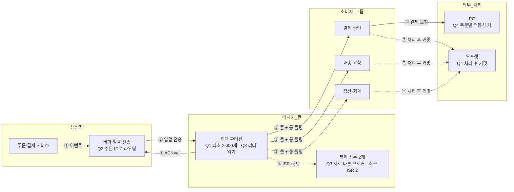

# 4장 분산 메시지 큐 — 태환 · S2 안전결제

> **한 줄 요약**: 주문 ID별 파티션과 최소 ISR 2개의 복제로 이벤트를 전달하고, 업무별 소비자 그룹과 PG 멱등성 키로 결제를 처리한다.

## 1. 전제

| 핵심 숫자 | 값 | 계산식 |
|---|---|---|
| 피크 쓰기 처리량 | 10만 건/s, 200MB/s | 2만 건/s × 5 × 2KB |
| 30일 저장량 (사본 포함) | 360TB | 40MB/s × 10⁵초 × 30일 × 3 |
| 최소 파티션 수 | 2,000개 | 최대(200MB/s ÷ 10MB/s, 10만 건/s ÷ 50건/s) |

- **교재와 다른 제약**: 30일 보관, 유실과 중복 결제 불허, 주문별 순서 보장

## 2. 결정 4개

| # | 결정 | 질문 | 내 선택 | 근거 (한 줄) | 감수한 것 |
|---|---|---|---|---|---|
| Q1 | 규모 | 피크 처리량과 소비 속도를 고려할 때 파티션은 몇 개 필요한가? | 최소 2,000개 | 피크 10만 건/s를 소비자당 50건/s로 처리하려면 2,000명 필요 | 파티션과 소비자가 많아 운영 부담 증가 |
| Q2 | 파티션·전송 | ① 주문별 순서를 위해 어떻게 배치할까? ② 생산자는 어떻게 전송할까? | 주문 ID 키 / 버퍼 일괄 전송 | 같은 주문은 같은 파티션 / 네트워크 요청을 줄여 처리량 향상 | 특정 주문에 트래픽이 몰릴 가능성 / 전송 지연 |
| Q3 | 복제·ACK | 유실을 막기 위해 사본과 ACK, 읽기를 어떻게 구성할까? | 브로커별 사본 3개, ACK=all, 최소 ISR 2개, 리더 읽기 | 동기화된 사본에 저장한 뒤 응답 | ISR이 2개 미만이면 쓰기 거부로 가용성 저하 |
| Q4 | 소비·전달 | ① 소비 방식과 그룹은? ② 결제 후 커밋 전 장애에서 중복을 어떻게 막을까? | 풀 + 롱 폴링, 업무별 그룹, 처리 후 커밋, 주문별 PG 멱등성 키 | 그룹별 독립 처리와 재처리 시 중복 결제 방지 | 중복 전달과 재조정 지연, PG의 멱등성 보장에 의존 |

## 3. 시스템 전체 설계도

실선 = 핵심 흐름 · 점선 = 복제·비동기 · 굵은 선 = 돌발 대응

![[메시지큐설계_태환_2026-11-08.excalidraw]]

**메시지 발행 → 소비**: ① 이벤트 생성 → ② 주문 ID로 라우팅해 일괄 전송 → ③ ISR 복제 → ④ ACK → ⑤ 각 그룹이 메시지 풀 → ⑥ 업무 처리 → ⑦ 처리 후 오프셋 커밋

## 4. 교재와 다르게 간 곳

| 결정 | 교재 | 나 | 이 시나리오에서 왜 |
|---|---|---|---|
| 복제 조건 | ISR 기반 복제 | 최소 ISR 2개로 쓰기 제한 | 유실을 허용하지 않는 결제 이벤트 |
| 중복 결제 | 전달 방식 설정 가능 | 처리 후 커밋과 PG 멱등성 키 | 재처리 시 중복 결제 방지 |

## 5. 미팅 안건

- **가장 자신 없는 결정**: 풀과 롱 폴링, 소비자 그룹 구성
- **같이 이야기할 질문**: 결제 소비자의 재조정 지연을 줄이면서 피크 처리량을 확보하려면 소비자 그룹과 파티션을 어떻게 운영할까?
